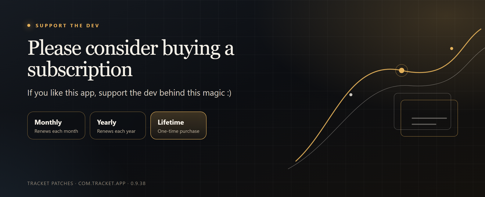
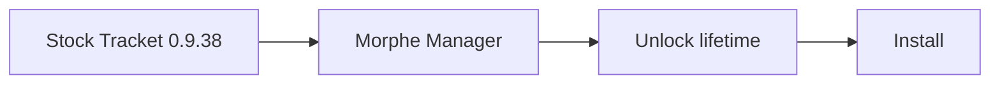
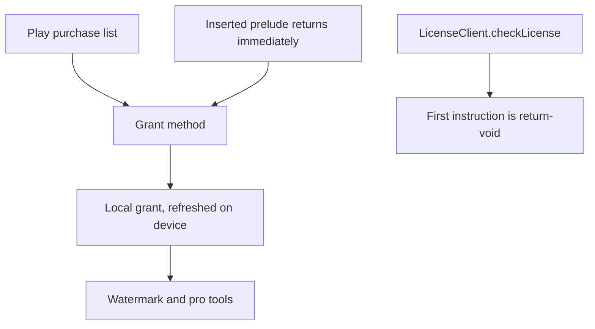

<p align="center">
  <a href="https://play.google.com/store/apps/details?id=com.tracket.app">
    
  </a>
</p>

<p align="center">
  <a href="https://play.google.com/store/apps/details?id=com.tracket.app"></a>
  &nbsp;
  <a href="https://morphe.software/add-source?github=contactjayclatty/tracket-patches&name=Tracket%20patches"></a>
</p>

<p align="center">
  <a href="https://github.com/contactjayclatty/tracket-patches/releases/latest"></a>
  <a href="https://github.com/contactjayclatty/tracket-patches/releases/latest"></a>
  <a href="LICENSE"></a>
  <a href="https://github.com/MorpheApp/morphe-cli"></a>
</p>

# Tracket patches

Patches for Tracket (`com.tracket.app`) **0.9.38**, versionCode 237, by [Mara Quill](#support-the-developer).

## Support the developer

Please consider buying a subscription if you like this app. Support the dev behind this magic :)

Tracket sells three plans. The names below are the ones in version 0.9.38. The price is the one Google Play shows in the app.

| Plan | How it bills | Product |
| --- | --- | --- |
| **Monthly** | Renews every month | Play subscription |
| **Yearly** | Renews every year | Play subscription |
| **Lifetime** | Pay once | `pro_lifetime` |

> [!TIP]
> Open Tracket, choose **See all plans**, and pick Monthly, Yearly, or Lifetime. [Get Tracket on Google Play](https://play.google.com/store/apps/details?id=com.tracket.app).

## On this page

- [The patch](#the-patch)
- [Add it in Morphe Manager](#add-it-in-morphe-manager)
- [You already have the file](#you-already-have-the-file)
- [Desktop](#desktop)
- [Before you patch](#before-you-patch)
- [Build](#build)
- [How the patch works](#how-the-patch-works)
- [For the Tracket developer](#for-the-tracket-developer)
- [Cut the next release](#cut-the-next-release)

## The patch

| | |
| --- | --- |
| **Name** | Unlock lifetime |
| **Default** | On |
| **You get** | The app treats a lifetime purchase as active, and a re-signed APK gets past the Play license check |
| **Works on** | Stock Tracket 0.9.38 only |



## Add it in Morphe Manager

1. Install [Morphe Manager](https://github.com/MorpheApp/morphe-manager).
2. Tap **Add this source** at the top of this page. Manager asks before it adds anything.
   By hand: <kbd>Sources</kbd> → <kbd>+</kbd> → <kbd>Remote</kbd>, then paste:

   ```text
   github.com/contactjayclatty/tracket-patches
   ```

3. Open Tracket. Leave **Unlock lifetime** enabled.
4. Patch the stock 0.9.38 APK and install the result.

Manager reads [`patches-bundle.json`](patches-bundle.json) on `main` and downloads [`patches-1.0.0.mpp`](https://github.com/contactjayclatty/tracket-patches/releases/download/v1.0.0/patches-1.0.0.mpp) from the [v1.0.0 release](https://github.com/contactjayclatty/tracket-patches/releases/tag/v1.0.0). A repository source updates when a newer release is published.[^1]

> [!IMPORTANT]
> Use a stock Tracket **0.9.38** APK. Any other version is refused.
> This changes the copy on the phone. Tracket's servers can still refuse the account.

> [!WARNING]
> A patch source decides what is written into the app. Add this source only if you trust it.

## You already have the file

Import [`dist/patches-1.0.0.mpp`](dist/patches-1.0.0.mpp) from <kbd>Sources</kbd> → <kbd>+</kbd> → <kbd>Local</kbd>.

A local file stays on the version you imported. When a new release comes out, replace the file yourself.

## Desktop

From a stock `0.9.38` APK, with [Morphe desktop CLI](https://github.com/MorpheApp/morphe-cli) 1.18.1:

```text
morphe patch --bytecode-mode=FULL -p patches-1.0.0.mpp -o tracket-0.9.38-morphe.apk tracket-0.9.38.apk
```

`--bytecode-mode=FULL` is the mode this bundle was checked with.

To turn the patch off, pass `--options-file` with:

```json
[
  {
    "meta": {
      "source": "patches-1.0.0.mpp"
    },
    "patches": {
      "Unlock lifetime": {
        "enabled": false
      }
    }
  }
]
```

## Before you patch

| | |
| --- | --- |
| App | Tracket, package `com.tracket.app` |
| Version | 0.9.38 only, versionCode 237 |
| Patch | Unlock lifetime, on by default |
| Needs | Morphe Manager, or Morphe desktop CLI 1.18.1 |
| License | [GPL-3.0-or-later](LICENSE) |

The on-device grant does not record monthly, yearly, or lifetime. Any active grant is treated as pro. Lifetime is the product this patch is named for (`pro_lifetime`).

A newer Tracket build ships new obfuscated names. This release fails on that build instead of guessing. The names pinned to 0.9.38 are `Lql3`, `Lxb6`, `Le2`, `Lmr`, `Lk01`, `Lsq`, `Ltz7`, `Luy7`, `Lhy7`, and `Lqp1`.

## Build

JDK 17 or newer, and `morphe-desktop-1.18.1-all.jar` from the Morphe desktop CLI.

```text
$env:MORPHE_JAR = 'C:\path\to\morphe-desktop-1.18.1-all.jar'
pwsh -File build.ps1
```

The script writes `dist/patches-1.0.0.mpp`. The banner at the top of this page is rendered from [`docs/banner.html`](docs/banner.html).

## How the patch works

Tracket 0.9.38 decides “pro” on the phone. A Play purchase list is handed to one method. That method seeds a local key, publishes a short-lived grant, and a coroutine refreshes the grant about once a minute. Screens that hide a watermark or a locked tool read that grant. They do not read a server receipt.

The patch makes two edits in [`LifetimeUnlock.java`](src/tracket/morphe/LifetimeUnlock.java). Both are on by default.



1. **Grant method.** Morphe searches every class for a `void` method with one `java.util.List` parameter whose body contains both `purchaseTime` and `SHA-256`. In 0.9.38 that method is the purchase handler. A prelude is inserted at instruction 0:
   - Read the ratchet object `Lql3.D`.
   - Hash 16 random bytes with `SHA-256` and store the digest in `Lql3.B`. Clear `Lql3.C`. Set epoch `Lql3.A` to `0`.
   - Publish `new Date(now)` through the handler’s `Luy7` field, then call the handler’s own `b()` so the app mints its normal grant.
   - Start the existing refresher (`Lsq` via `Ltz7.g`) and store the job on the handler’s field `e`.
   - `return-void`. The original method body stays in the dex and never runs, so an empty purchase list cannot clear the key.
2. **Play license check.** `com.pairip.licensecheck.LicenseClient.checkLicense` gets `return-void` as its first instruction. A re-signed APK would otherwise fail this check and never reach the editor. This build has no `libpairip` native library. The license client is not the subscription.

The grant itself does not encode Monthly, Yearly, or Lifetime. Any live grant is treated as pro. Lifetime is the Play product this patch is named for (`pro_lifetime`).

The helper names are hardcoded for this R8 pass: `Lql3`, `Lxb6`, `Le2`, `Luy7`, `Lmr`, `Lk01`, `Lsq`, `Ltz7`, `Lhy7`, `Lqp1`. The handler class is not hardcoded. The fingerprint finds it. `CheckPrelude.java` prints the patched method so a maintainer can confirm the prelude. It is not inside the `.mpp`.

Apply with `--bytecode-mode=FULL`. That is the mode this bundle was checked with. Success is a Morphe log line `Applied: Unlock lifetime`, then the app opening on 0.9.38 without the Play license screen. A server that checks the account can still say no.

<details id="for-the-tracket-developer">
<summary><strong>For the Tracket developer</strong> — how a new build retires this patch, and where to send a removal request</summary>

## For the Tracket developer

Removal requests go to [contactjayclatty@pm.me](mailto:contactjayclatty@pm.me).

This patch only rewrites the installed APK. It never sends a Play purchase token. The key it stores is a SHA-256 of random bytes created on the device. Anything that treats that local grant as proof of payment will follow it.

A build you ship can make this `.mpp` stop applying, or make it useless. The rows are the 0.9.38 behavior.

| What you change | What this patch does |
| --- | --- |
| Ship a `versionName` other than `0.9.38` | Morphe hides the patch. Compatibility is pinned to that version. People who stay on 0.9.38 keep the old APK. |
| Make the purchase method no longer `void (List)` with both `purchaseTime` and `SHA-256` in the body | The patch fails closed: `Tracket grant method was not found`. Nothing is written. |
| Remove `com.pairip.licensecheck.LicenseClient.checkLicense` | The patch fails closed: `LicenseClient.checkLicense was not found`. |
| Rename `Lql3`, `Lxb6`, `Lmr`, `Lsq`, or `Ltz7` and leave the method fingerprint alone | The patch still applies. The rewritten app calls names that no longer exist. |
| Unlock watermark, export, and the editor from a purchase your server verified with Google Play | The local grant stops being enough. This patch cannot mint a Play token. |

The durable fix is the last row. Pro features should follow a check on your API (`tracket-api.tracket-app-dev.workers.dev` in this build), using a purchase token Google Play can verify. The on-device grant can stay as a cache of that answer. Pairip only checks that the install is licensed. It is not a subscription check, which is why skipping `checkLicense` is enough to let a re-signed APK start.

If you maintain **this** repository instead of Tracket: a new app build needs a new fingerprint pass in `LifetimeUnlock.java`, a new compatibility version, and a release from [Cut the next release](#cut-the-next-release). Do not point the old `download_url` at a patch that still says 0.9.38.

</details>

## Cut the next release

<details>
<summary>Version bump checklist</summary>

1. Bump `version` in `patches-bundle.json` and in `build.ps1`.
2. Rebuild. Keep the asset name `patches-<version>.mpp`.
3. Set `download_url` to `https://github.com/contactjayclatty/tracket-patches/releases/download/v<version>/patches-<version>.mpp`.
4. Set `created_at` and `description` for that version. Keep the subscription ask in the description.
5. Commit `patches-bundle.json` on `main`.
6. Create a GitHub release tagged `v<version>` and attach that `.mpp` under the same file name.

</details>

---

<p align="center">
  Monthly · Yearly · Lifetime<br>
  <a href="https://play.google.com/store/apps/details?id=com.tracket.app"><strong>Support the dev behind this magic :)</strong></a>
</p>

[^1]: Local `.mpp` imports do not auto-update. Remote GitHub sources do.
