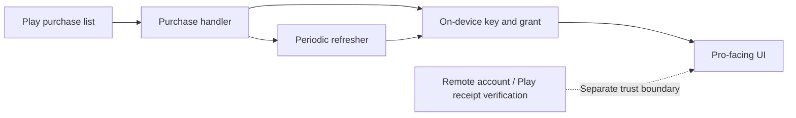

# Technical notes

> [!NOTE]
> This document describes the **Tracket 0.9.38 / versionCode 237** implementation examined for the repository's first release. It is not a statement about current or future Tracket versions.

[← Back to the project overview](../README.md) · [Compatibility and troubleshooting](TROUBLESHOOTING.md) · [Release maintenance](MAINTAINING.md)

---

## What the patch changes

The repository's one published patch is called **Unlock lifetime**. It makes two edits to the locally installed application:

| Area | Observed behavior in 0.9.38 | Patch effect |
| :-- | :-- | :-- |
| On-device entitlement | A purchase-list handler establishes a short-lived local pro grant, and a coroutine refreshes it | Replaces the handler's entry path with a prelude that publishes the local grant |
| Play installation licensing | `LicenseClient.checkLicense` can reject a re-signed APK | Returns from that client-side method before its original implementation runs |

This is **not** a Google Play purchase. It does not issue a purchase receipt or product token, and it cannot establish a server-side entitlement.

## The on-device model

In the examined build, a Play purchase list is passed to a method that prepares a local key, publishes a time-based grant, and starts a refresh coroutine. UI code consumes this local grant when deciding whether to show premium controls or a watermark.



> [!IMPORTANT]
> The dotted line represents the **separate verification boundary**, not proof that the examined UI performed a server receipt check. A server can reject an account even when a local grant exists.

## Implementation notes

The source of truth is [`src/tracket/morphe/LifetimeUnlock.java`](../src/tracket/morphe/LifetimeUnlock.java). These notes reflect the existing implementation and are deliberately pinned to the examined app version.

### Grant handler

The patch searches for a `void` method with a single `java.util.List` parameter whose implementation contains both `purchaseTime` and `SHA-256`. The containing class is found by this fingerprint instead of by a hardcoded class name.

For the matched 0.9.38 handler, an inserted entry prelude:

1. Reads the local ratchet singleton.
2. Creates a digest of 16 random bytes and resets existing state.
3. Publishes the current date through the handler's local field and calls the app's existing grant-generation method.
4. Starts the application's grant-refresher coroutine and records the job.
5. Returns before the original purchase-list code runs.

The original dex method body remains present, but the inserted return makes it unreachable on that path.

### Play licensing

The patch also changes `com.pairip.licensecheck.LicenseClient.checkLicense` so its first instruction returns. In the examined version, this avoids the startup check that would otherwise reject a re-signed APK. The checked build does not have a `libpairip` native library.

**Do not conflate the two checks:** the Play license check addresses installation licensing, whereas the application's local grant influences its premium UI.

### Obfuscation and compatibility

This build uses R8-obfuscated helpers. Names referenced in the Java implementation include:

```text
Lql3  Lxb6  Le2   Lmr   Lk01
Lsq   Ltz7  Luy7  Lhy7  Lqp1
```

They are pinned to Tracket **0.9.38**, not stable APIs. If the underlying app changes, the method fingerprint can fail or hardcoded helper references can become invalid. The published patch deliberately declares compatibility only with 0.9.38.

### Verification boundaries

The repository documents verification with Morphe desktop CLI **1.18.1** using `--bytecode-mode=FULL`. The reported patcher success marker is:

```text
Applied: Unlock lifetime
```

This indicates application of the patch, **not** proof of an authenticated Play purchase, stable runtime behavior on every device, or a server-side entitlement. The separate `CheckPrelude.java` inspection helper described by the project is not packaged in the distributed `.mpp`.

## Guidance for the Tracket developer

Removal or security-related requests can be sent to [contactjayclatty@pm.me](mailto:contactjayclatty@pm.me).

The most durable mitigation is to make premium access dependent on purchase verification performed by a trusted backend. The local grant can remain a cache of a server-verified result, but should not itself be treated as proof of payment.

| Change in Tracket | Implication for this release |
| :-- | :-- |
| Change the declared version beyond 0.9.38 | Morphe compatibility no longer matches, although old APK copies may still exist |
| Remove the purchase handler's `void(List)` and string fingerprint | The current fingerprint fails to locate the handler |
| Remove or change the Play license class | The current license method lookup fails |
| Change only obfuscated helper names | The patch may apply but references can fail at runtime |
| Require a server-verified Google Play purchase token for premium features | A locally established grant is insufficient |

The examined build referenced `tracket-api.tracket-app-dev.workers.dev`. This is an observation about that build, not a claim about any other release or the present backend.

## Files relevant to reviewers

| File | Purpose |
| :-- | :-- |
| [`LifetimeUnlock.java`](../src/tracket/morphe/LifetimeUnlock.java) | Patch implementation |
| [`patches-bundle.json`](../patches-bundle.json) | Release metadata consumed by the remote source |
| [`build.ps1`](../build.ps1) | Reproducible compilation and packaging entry point |
| [`README.md`](../README.md) | User-facing overview, compatibility and entry points |

---

*Independent community documentation. Tracket and Google Play are separate products and services; this repository does not provide official entitlements.*